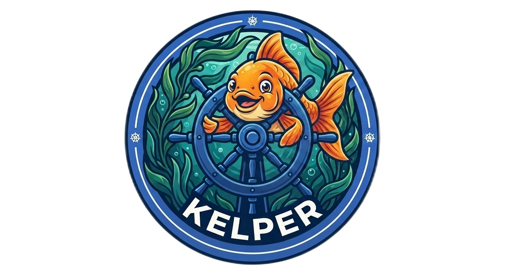

<p align="center">
  
</p>

# kelper

A Go binary that wraps `kubectl` with enhanced output formatting and cluster tooling. Zero external tool dependencies — works wherever `kubectl` works.

- **Decodes secrets** automatically on `get ... -o yaml` output.
- **Cleans up YAML** by stripping the noise Kubernetes injects (`uid`,
  `creationTimestamp`, `resourceVersion`, `status`, and per-kind defaults), so
  output is paste-ready for a manifest.
- **Healthcheck** — a diagnosis engine covering pods, workloads, ReplicaSets,
  nodes, resource limits, volumes, certificates, Services and custom resources.
  Prints severity-ranked tables with an exit code, streams changes with
  `--watch`, or opens a live dashboard when run bare.
- **Embedded k9s** — `kelper k9s` launches the full k9s terminal UI, bundled in
  the binary.
- **Pod inspectors** — `images`, `resources`, and `volumes` render per-container
  detail with copy-paste-friendly indented YAML blocks.
- **Image pull through the cluster** — `pull` saves the image a pod is running
  to a local `docker load`-able or OCI archive, even when the registry is only
  reachable from inside the cluster.
- **Kubeconfig generation** — create readonly, admin, cluster-wide, or
  resource-scoped users via CSR + RBAC, either with flags or an interactive
  wizard.
- **Client-side api-server load balancing** — point a single context at a
  comma-delimited list of api-server endpoints and `kelper` will fail over to the
  next live one automatically.
- **Transparent passthrough** — anything kelper doesn't handle natively is
  forwarded straight to `kubectl`.

## Installing

### Pre-built binaries (recommended)

Grab the latest binary for your OS/arch from the
[Releases](https://github.com/jthunderbird/kelper/releases) page, then:

```bash
chmod +x kelper-linux-amd64
sudo mv kelper-linux-amd64 /usr/local/bin/kelper
alias k=kelper   # optional
k --help
```

### Container image (GHCR)

```bash
docker pull ghcr.io/jthunderbird/kelper:latest
docker run --rm -v ~/.kube:/root/.kube ghcr.io/jthunderbird/kelper:latest get pods -A
```

The image bundles `kubectl`, so it works standalone.

### From source

```bash
git clone https://github.com/jthunderbird/kelper.git
cd kelper
make build          # or: go build -o kelper ./cmd/kelper/
sudo make install   # installs to /usr/local/bin/kelper
alias k=kelper
k help
```

The original bash script is available as `kelper.sh` in the repo root as a
lightweight reference alternative.

## Shell Completion

Generate the script with `--output` (`-o`) and run the two commands it prints:

```bash
kelper completion bash -o ~/.kelper-completion.bash
```

```
Wrote bash completion to /home/you/.kelper-completion.bash

Run these two commands:

  echo "source /home/you/.kelper-completion.bash" >> ~/.bashrc
  source ~/.bashrc
```

Supported shells: `bash`, `zsh`, `fish`, `powershell`. Run
`kelper completion --help` to see them. Without `--output` the script goes to
stdout, so it can also be sourced directly:

```bash
source <(kelper completion bash)
```

The script must be **sourced**, not executed. bash additionally needs the
`bash-completion` package installed; zsh needs `autoload -U compinit && compinit`
in `~/.zshrc`.

### Completing `k` and other aliases

kelper is commonly symlinked or copied to a shorter name such as `k`. The
generated script completes `k` as well as `kelper` by default:

```bash
ln -s "$(which kelper)" ~/.local/bin/k   # k now completes too
```

Use `--alias` to change the list, or to turn it off:

```bash
kelper completion bash --alias k,kc -o ~/.kelper-completion.bash
kelper completion bash --alias ""     -o ~/.kelper-completion.bash
```

For zsh, aliases are registered when the script is sourced. Dropping the file
into `$fpath` for autoloading picks up `kelper` only, so prefer the
`source`-from-`~/.zshrc` approach shown above.

## Usage

`kelper` has a set of native commands and otherwise passes input straight
through to `kubectl`.

```bash
kelper <command> [args]            # run a native command
kelper <any kubectl args>          # anything else is forwarded to kubectl
kelper --kubeconfig <path> <args>  # use a specific kubeconfig
```

| Command       | Description                                                              |
| ------------- | ------------------------------------------------------------------------ |
| `healthcheck` | Diagnose cluster health (live dashboard when run with no target).        |
| `k9s`         | Launch the embedded k9s terminal UI.                                     |
| `images`      | Show container images per pod.                                           |
| `resources`   | Show resource limits and requests per pod.                               |
| `volumes`     | Show volume mounts and pod volumes per pod.                              |
| `kubeconfig`  | Generate kubeconfig files for cluster users (wizard when run bare).      |
| `pull`        | Save the image a pod is running to a local archive.                      |
| `completion`  | Generate shell completion scripts (bash/zsh/fish/powershell).           |

Aliases: `health`; `image`/`imgs`/`img`; `resource`/`res`; `volume`/`vols`/`vol`.

## In action

### Secrets — auto-decoded

Any `get secret ... -o yaml` has its `data` base64-decoded and printed flush
left for easy copying:

```bash
$ kelper get secret -n kiali grafana-auth -o yaml
KEY: password
─────────────────────────
prom-operator
```

### `-o yaml` — cleaned up

For any non-secret `get ... -o yaml`, `kelper` removes the auto-mutated fields so
the result is ready to drop into a YAML file. Add `--raw` to bypass and get the
untouched `kubectl` output.

```bash
$ kelper get po -n flux-system helm-controller-678f5576df-g7scx -o yaml
apiVersion: v1
kind: Pod
metadata:
  labels:
    app: helm-controller
  name: helm-controller-678f5576df-g7scx
  namespace: flux-system
spec:
  containers:
    - image: docker.io/fluxcd/helm-controller:v1.4.0
      name: manager
      ...
```

### `images` — pods and their images

```bash
$ kelper images -n kyverno
pod: kyverno-admission-controller-5d8986c8b6-2g7gr (-n kyverno)
────────────────────────────────────────────────────────────────

  initContainers:
    kyverno-pre:
      image: registry1.dso.mil/ironbank/opensource/kyverno/kyvernopre:v1.13.4

  containers:
    kyverno:
      image: registry1.dso.mil/ironbank/opensource/kyverno:v1.13.4
```

### `healthcheck`

Runs a set of independent checks against the cluster and reports severity-ranked
findings, each with the evidence behind it and a suggested fix.

```bash
$ kelper healthcheck -n kelper-health-test
ERROR (8)
 NAMESPACE           KIND                   NAME                       REASON               MESSAGE
 kelper-health-test  Deployment             bad-image                  ReplicasUnavailable  0/1 replicas available
 kelper-health-test  PersistentVolumeClaim  unbound                    PVCPending           claim is unbound; pods using it cannot start
 kelper-health-test  Pod                    bad-image-fbf75bccf-6gxn6  ImagePullBackOff     container "app" is ImagePullBackOff
 kelper-health-test  Pod                    unschedulable              Unschedulable        cannot be scheduled: 0/3 nodes are available...
 kelper-health-test  Service                no-endpoints               NoReadyEndpoints     service has no ready endpoints; traffic to it will fail

WARN (1)
 NAMESPACE           KIND  NAME                      REASON        MESSAGE
 kelper-health-test  Pod   crasher-6db794d66d-hv7n7  RestartChurn  container "app" restarted 2 time(s), last 14s ago — still inside the 10m0s backoff window

Summary: 8 ERROR, 1 WARN
```

The exit code is non-zero when anything at warning level or above is found, so
it works as a CI gate.

#### Checks

Run `kelper healthcheck --list-checks` for the current list.

| Check | What it catches |
|---|---|
| `pods` | Pending and unschedulable pods, init-container failures, OOMKills, evicted and stuck-terminating pods |
| `restarts` | Pods that restarted inside the kubelet backoff window — Running and Ready right now, but about to crash again |
| `workloads` | Deployments, StatefulSets, DaemonSets, Jobs and CronJobs, by status conditions and rollout progress as well as replica counts |
| `replicasets` | Stale ReplicaSets still running pods after an incomplete rollout, and orphaned ones |
| `nodes` | Readiness, memory/disk/PID pressure, cordoned nodes, overcommit and utilization |
| `limits` | Containers near or over their CPU/memory limits (requires metrics-server) |
| `volumes` | PVCs near capacity or out of inodes (requires `nodes/proxy`), and unbound claims |
| `certs` | API server, kubelet and kubeconfig client certificate expiry, plus pending CSRs |
| `services` | Services whose selector matches no ready pods |
| `custom` | Custom resources reporting a failing `Ready`/`Available`/`Healthy` condition |

Checks whose data source is unavailable are skipped rather than failed, and the
gap is reported in a single `Degraded:` line — so kelper stays useful against
clusters without metrics-server or without node proxy permission.

```bash
kelper healthcheck -A                      # every namespace
kelper healthcheck -n prod --detail        # expand evidence and remediation
kelper healthcheck --checks pods,restarts  # run only these checks
kelper healthcheck --skip custom           # skip the custom resource scan
kelper healthcheck --severity error        # report errors and above only
kelper healthcheck --watch --interval 15s  # stream only what changed
```

#### Live dashboard

Run `kelper healthcheck` with no target to open the dashboard. It is driven by
cluster watch events rather than polling, so findings update as the cluster
changes; metrics, volume stats and certificates refresh on their own timers.

```
┌──────────── kelper health ─────────────┐┌───────────────────── nodes ──────────────────────┐
│ 21:37:17                               ││ node-1  cpu ░░░░░░░░░░   7%  mem █████░░░░░  59% │
│ critical 0  error 10  warn 0  info 0   ││ node-2  cpu ░░░░░░░░░░   5%  mem ██████░░░░  64% │
│ 112 pods  3 nodes                      ││ node-3  cpu ░░░░░░░░░░   7%  mem ██████░░░░  64% │
└────────────────────────────────────────┘└──────────────────────────────────────────────────┘
┌──────────────── findings ──────────────────┐┌──────────────── detail ─────────────────┐
│ SEV   NAMESPACE  KIND  NAME       REASON   ││ ERROR  Unschedulable                    │
│ ERROR default    Pod   web-x9f2j  Unsched..││ pod/web-x9f2j -n default                │
└────────────────────────────────────────────┘└─────────────────────────────────────────┘
```

| Key | Action |
|---|---|
| `/` | filter findings by text |
| `s` | cycle minimum severity |
| `p` | pause or resume live updates |
| `esc` | clear filters |
| `?` | help |
| `q` / `ctrl-c` | quit |

### `k9s`

kelper embeds [k9s](https://github.com/derailed/k9s), so the full terminal UI is
available without installing it separately. Arguments pass straight through.

```bash
kelper k9s                 # launch k9s
kelper k9s -n kube-system  # any k9s flag works
```

### `pull`

Saves the image a pod's container is running to a local archive, using only
Kubernetes API access — useful when the image lives in a registry the cluster
can reach but your workstation cannot.

```bash
$ kelper pull keycloak-869969bcc7-sk7bf -n keycloak
kelper pull will change pod keycloak/keycloak-869969bcc7-sk7bf:
  - add ephemeral container "kelper-pull-092829" running quay.io/keycloak/keycloak:26.0 to pull the image from inside the pod
  - the container stops when the pull ends, or after 10m0s at the latest
  - as with kubectl debug, the stopped container stays listed on the pod
    until the pod is next recreated; nothing keeps running
Continue? [y/N]: y
Waiting for helper container kelper-pull-092829...
Saved keycloak_09a381c715ab.tar (quay.io/keycloak/keycloak:26.0, 226.8 MiB) in 4.4s

$ docker load -i keycloak_09a381c715ab.tar
```

kelper adds an ephemeral container to the pod, injects a small static fetcher
into it, and pulls the image by its **running digest** through the pod's own
network path, streaming the archive back over `exec`. Pull secrets from the pod
and its service account are used for registry authentication; they are passed
to the fetcher over stdin and never written to disk.

```bash
kelper pull web-0 -c app -o web.tar             # pick a container and output path
kelper pull web-0 --format oci                  # OCI image layout instead of docker
kelper pull web-0 --helper-image busybox:1.37   # target image has no shell
kelper pull web-0 --ca registry-ca.pem          # private registry CA
kelper pull web-0 -y                            # skip the confirmation prompt
```

**The pod is changed.** Like `kubectl debug`, each pull adds an ephemeral
container; once stopped it stays listed on the pod until the pod is next
recreated, with nothing left running. kelper asks before making the change.
The helper always stops on its own by `--timeout`, even if kelper is
interrupted.

**Helper image.** The helper runs the target's own image (already on the node,
so nothing is pulled), which must provide `sh`, `cat`, `chmod`, `sleep` and
`rm`. kelper checks this before changing the pod. For distroless or scratch
images, pass `--helper-image` with any image that has them and is available to
the node.

**Limitations.**

- Images side-loaded onto nodes (`ctr import`, air-gap tarballs) or referenced
  by image ID cannot be pulled: no registry serves them.
- Registry mirrors and credentials configured on the node (containerd mirror
  config, kubelet credential providers) are not visible from inside the pod; the
  pull goes to the registry in the image reference using the pod's pull secrets.

**RBAC.** `get` on pods, nodes, serviceaccounts and secrets; `patch` on
`pods/ephemeralcontainers`; `create` on `pods/exec`.

### `kubeconfig`

Generates a client certificate, approves its CSR, creates matching RBAC, and
writes a ready-to-use kubeconfig.

```bash
kelper kubeconfig                 # launches the interactive wizard
kelper kubeconfig readonly        # cluster-wide readonly, generated username
kelper kubeconfig readonly --user john -n kyverno -o john-ro.yaml
kelper kubeconfig admin --user jane
kelper kubeconfig scoped --user ci -n build --resources pods,configmaps --verbs get,list
```

| Account type | Grants                                        |
| ------------ | --------------------------------------------- |
| `readonly`   | `get`, `list`, `watch` on everything          |
| `admin`      | full access                                   |
| `scoped`     | the `--resources`/`--verbs`/`--apigroups` you specify |

**Scope.** Accounts are **cluster-wide by default** (ClusterRole +
ClusterRoleBinding). Pass `--namespace`/`-n` to restrict the account to a single
namespace instead, which creates a Role + RoleBinding and sets that namespace as
the generated context's default.

**Username.** `--user` is optional. When omitted, a name of the form
`<type>-<8 hex chars>` is generated, e.g. `readonly-3f9a1c07`. A supplied
username must be a valid RFC 1123 subdomain, since it is embedded in the Role
and RoleBinding names.

**API groups.** For `scoped`, `--apigroups` defaults to `*`. Use `core` to
select the core (legacy, unnamed) API group — pods, services, configmaps and so
on: `--apigroups core,apps`.

Re-running for an existing username issues a fresh certificate and updates that
user's Role/RoleBinding in place.

## API-server load balancing

`kubectl` accepts one — and only one — `server:` per cluster in a kubeconfig.
If that endpoint is down, you are stuck. `kelper` lifts that limit: list multiple
api-server endpoints, comma-delimited, in the `server:` field, and `kelper`
probes them in order and uses the first one that is reachable.

### Configure it

```yaml
# ~/.kube/config
apiVersion: v1
kind: Config
clusters:
  - name: prod
    cluster:
      certificate-authority-data: <ca>
      # comma-delimited list of api-server endpoints
      server: https://10.0.0.1:6443,https://10.0.0.2:6443,https://10.0.0.3:6443
contexts:
  - name: prod
    context:
      cluster: prod
      user: prod-admin
current-context: prod
users:
  - name: prod-admin
    user:
      client-certificate-data: <cert>
      client-key-data: <key>
```

### How it behaves

On each kubectl passthrough invocation `kelper`:

1. Reads the current context's `server` field and splits it on commas.
2. Probes each endpoint in order (a 2s TCP dial).
3. Logs a line to stdout for every endpoint that is down and moves on.
4. Uses the first reachable endpoint by rewriting a temporary single-server
   kubeconfig and handing it to `kubectl`.
5. If every endpoint is exhausted, exits non-zero with a `not connected` error.

```bash
$ kelper get pods -n flux-system
api-server https://10.0.0.1:6443 unreachable (dial tcp 10.0.0.1:6443: i/o timeout); trying next endpoint...
api-server https://10.0.0.2:6443 reachable; using it
NAME                                READY   STATUS    RESTARTS   AGE
helm-controller-678f5576df-g7scx    1/1     Running   0          20h
```

A single (non-delimited) `server:` value behaves exactly as before — no probing,
no temp kubeconfig.

## Releases & images

Every push to `main` runs the [`release`](.github/workflows/release.yml)
workflow, which:

- cross-compiles `kelper` for linux/macOS (amd64 + arm64) and windows (amd64) and
  attaches them to a GitHub Release, and
- builds and pushes the container image to
  `ghcr.io/jthunderbird/kelper` (`:latest`, the release tag, and the commit SHA).

## License

See [LICENSE](LICENSE).

kelper embeds [k9s](https://github.com/derailed/k9s), which is licensed under
the Apache License 2.0. See [NOTICE](NOTICE) for attribution.
